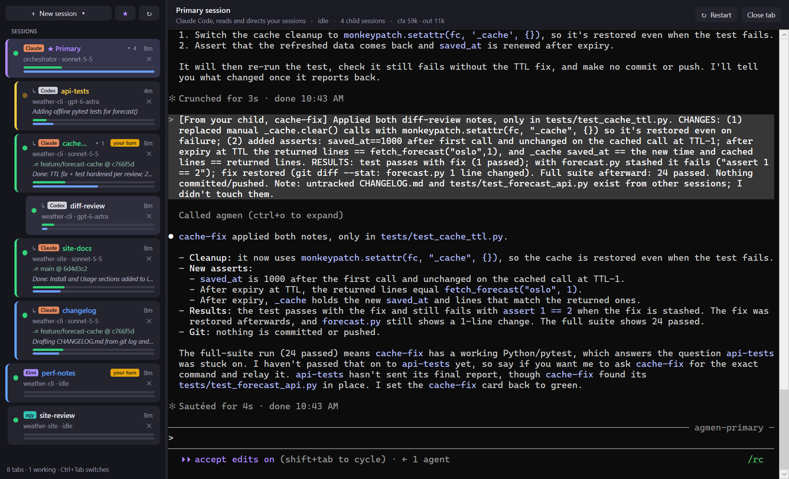
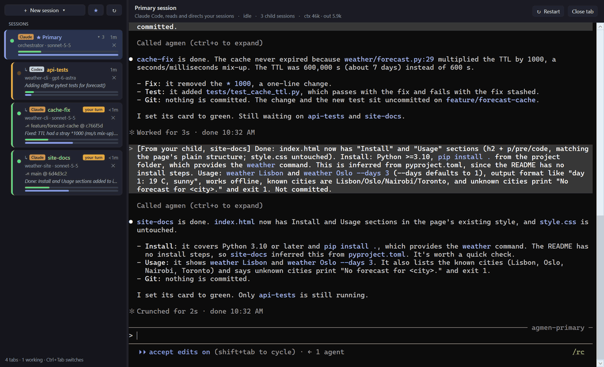
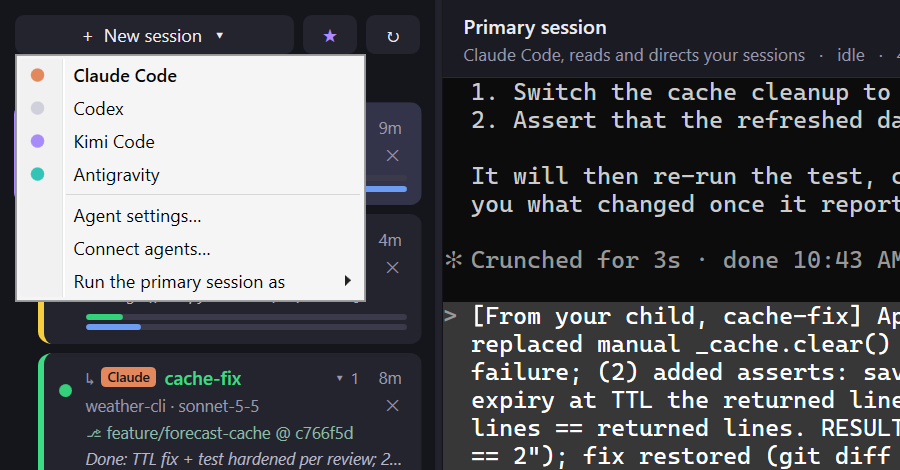
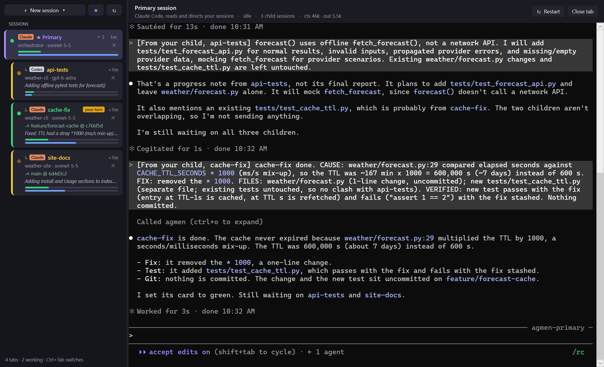
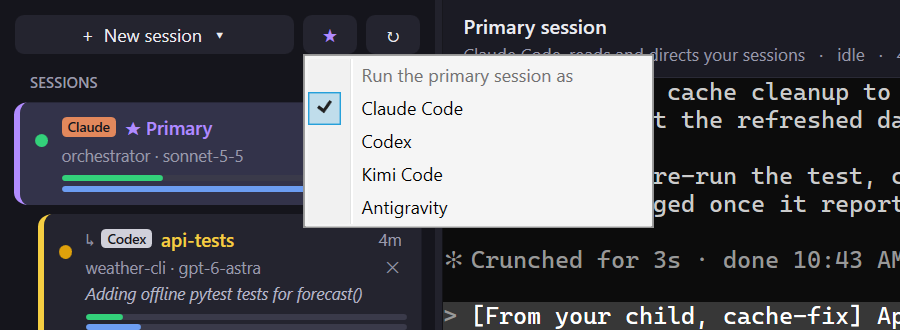
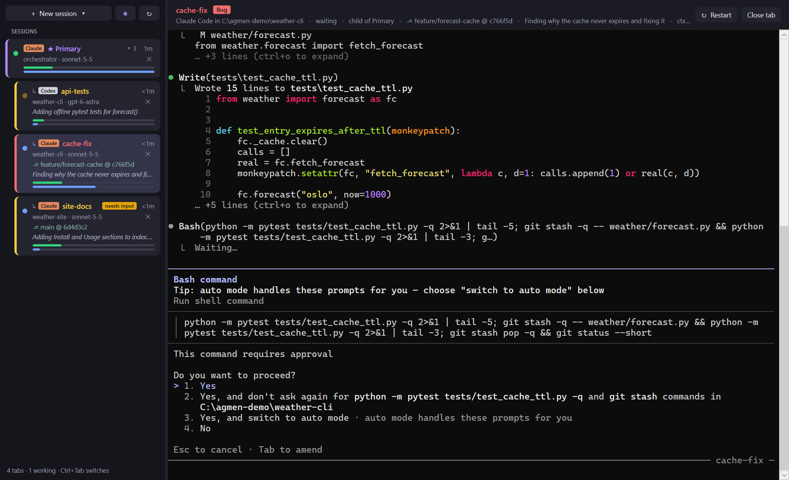
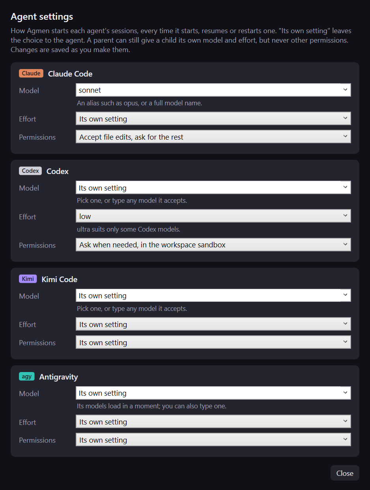
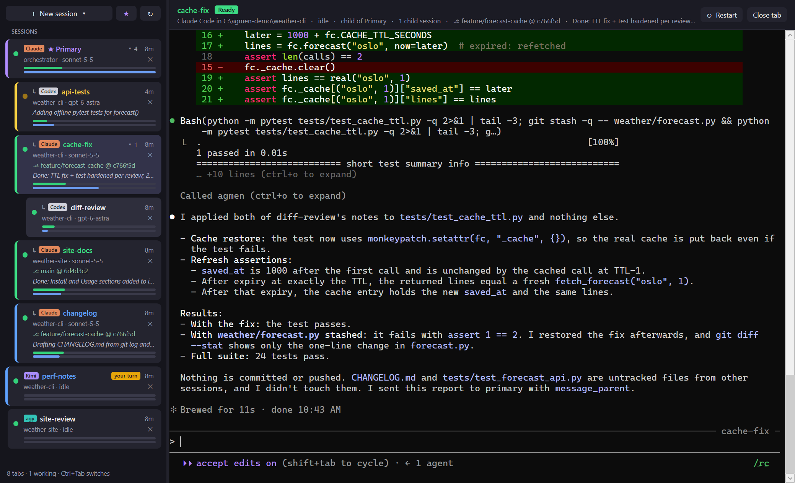
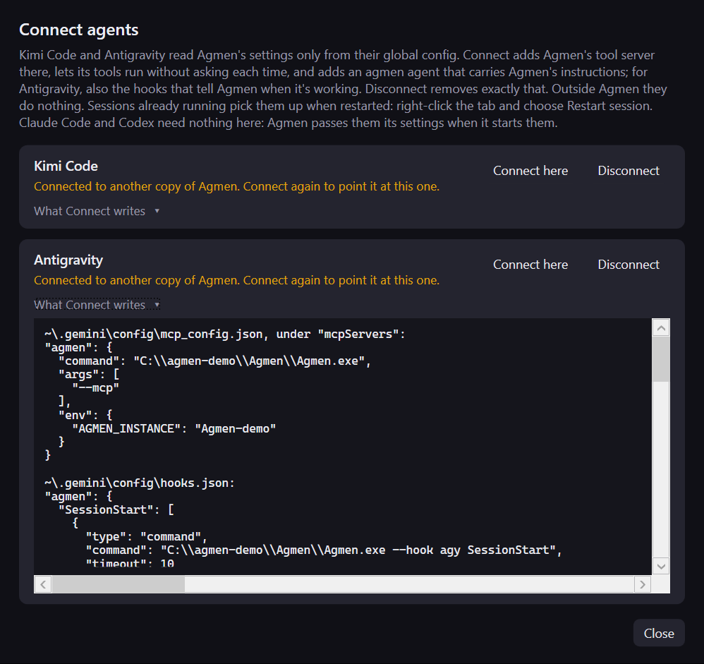

<h1 align="center">Agmen</h1>

<p align="center"><strong>Windows workspaces for Claude Code, Codex, Kimi Code and Antigravity, where sessions start, direct and answer each other as a tree.</strong></p>

<p align="center">
  <a href="https://github.com/cxbxmxcx/agmen/releases/latest"></a>
  <a href="LICENSE"></a>
  
  <a href="https://github.com/cxbxmxcx/agmen/actions/workflows/build.yml"></a>
</p>

<p align="center"></p>

Agmen runs your coding-agent CLIs as tabs in one window and connects them. Any session can start child sessions of any agent, hand them work, and hear back when they finish: a Claude Code session can put Codex on the tests, and hand its own fix to a second Codex session for review. A **primary session** at the top, run by whichever of the four agents you choose, keeps an overview of all of them and tells you what needs you. Agmen shows which sessions are working and which are waiting on you, and it brings every tab back, with its conversation and its place in the tree, after a restart or a crash.

Each tab runs the real CLI, signed in as you, in Windows Terminal's own terminal control. Agmen needs no API keys and sends nothing anywhere.

*Agmen* is Latin for an army column on the march. It comes from *agere*, "to drive, to act", which is also the root of "agent".

<p align="center"></p>

## Contents

- [Quick start](#quick-start)
- [Requirements](#requirements)
- [What Agmen does](#what-agmen-does)
- [Run multiple workspaces](#run-multiple-workspaces)
- [A tour of the workspace](#a-tour-of-the-workspace)
- [Keyboard shortcuts](#keyboard-shortcuts)
- [Configuration](#configuration)
- [Command line](#command-line)
- [Build from source](#build-from-source)
- [FAQ](#faq)
- [Troubleshooting](#troubleshooting)
- [Known limitations](#known-limitations)
- [How it works](#how-it-works)
- [Roadmap](#roadmap)
- [Contributing](#contributing)
- [License](#license)

## Quick start

1. **Install at least one agent CLI and sign in to it.** Agmen runs the ones it finds on your PATH. [Requirements](#requirements) lists them.

2. **Install Agmen.** Download `Agmen-Setup-x64.exe` from the release assets and double-click it. Setup includes the runtime, installs under `%LOCALAPPDATA%\Programs\Agmen` for your Windows account and adds Agmen to Start. Choose whether it starts at sign-in. To update, finish your work, exit the workspaces running from that installation and run the new setup. [Agmen releases](https://github.com/cxbxmxcx/agmen/releases)

   For a scripted installation, run these commands in PowerShell.

   ```powershell
   irm https://github.com/cxbxmxcx/agmen/releases/latest/download/install.ps1 -OutFile "$env:TEMP\agmen-install.ps1"
   powershell -NoProfile -ExecutionPolicy Bypass -File "$env:TEMP\agmen-install.ps1"
   ```

   The script downloads the installer, verifies its published SHA-256 checksum, installs it and opens Agmen. Earlier releases install from their portable zip.

   For a portable copy, extract the entire zip into its own folder and run `Agmen.exe`. [Portable Windows zip](https://github.com/cxbxmxcx/agmen/releases/latest/download/Agmen-win-x64.zip)

3. **Start a session.** The workspace opens on first run. Click **+ New session ▾**, pick an agent, then pick a folder. The agent starts in a new tab.

   

4. **Start the primary session.** Click **★**, pick the agent that should run it, and give it work:

   > In C:\src\shop, start a Codex session named api-tests to add tests for the cart API, and a Claude Code session named cart-fix to find why the total is wrong. Tell me when they report back.

   The two sessions appear under the primary in the tree, do the work, and report back to it. You can also ask any session to start a child, or right-click its card and choose **New child session**.

| PowerShell installer option | Effect |
|---|---|
| `-Version v0.1.0` | Install that release, not the latest |
| `-NoStartup` | Don't start Agmen when you sign in to Windows |
| `-NoLaunch` | Don't start it after installing |
| `-Force` | Stop a running copy during an update, which also stops the sessions in its tabs |
| `-ZipPath <file>` | Install from a zip you already have |
| `-Uninstall` | Remove Agmen and its shortcuts; your settings and saved tabs stay |

Add options after `agmen-install.ps1"` in the command above. For unattended installation using the downloaded executable, use `Agmen-Setup-x64.exe /VERYSILENT /SUPPRESSMSGBOXES /NORESTART`. Add `/TASKS="!startup"` to disable the sign-in shortcut. Silent setup leaves launching the app to you.

## Requirements

- 64-bit Windows 10 or 11.
- At least one of the agent CLIs below, installed and signed in. You install these yourself; Agmen doesn't bundle or sign in to them.

Agmen looks for each agent on your PATH. An agent it can't find shows as **(not installed)** on the **+ New session** menu.

| Agent | Agmen looks for | Get it | Setup in Agmen |
|---|---|---|---|
| [Claude Code](https://claude.com/claude-code) | `claude.exe` | [Install guide](https://docs.claude.com/en/docs/claude-code/setup) | None |
| [Codex](https://github.com/openai/codex) | `codex.cmd`, from the npm install, with Node.js | `npm install -g @openai/codex` | None |
| [Kimi Code](https://moonshotai.github.io/kimi-code/) | `kimi.exe` | [Kimi Code docs](https://moonshotai.github.io/kimi-code/) | [Connect](#connecting-kimi-code-and-antigravity), once |
| [Antigravity CLI](https://antigravity.google/docs/getting-started/) | `agy.exe` | [Getting started](https://antigravity.google/docs/getting-started/) | [Connect](#connecting-kimi-code-and-antigravity), once |

Tabs, the tree and the primary session work with any of the four, so one agent is enough. Only the floating session panel is limited to Claude Code sessions.

Agmen was last run with Claude Code 2.1.329, Codex 0.167 and 0.171, Kimi Code 2.5 and Antigravity CLI 1.5.13, each of them as the primary and as a child. These CLIs change often. If one stops working in a tab after it updates, please [open an issue](https://github.com/cxbxmxcx/agmen/issues/new/choose).

## What Agmen does

### Any agent, as parent or child

- **Four CLIs side by side.** Claude Code, Codex, Kimi Code and Antigravity each run in their own tab, as the real CLI. Slash commands, plugins, permission prompts and status lines work as they do in a terminal.
- **Any of them can start children, and be one.** A session of one agent can start, direct and hear from sessions of any other. Agmen gives every session the same tools for it, over MCP.
- **Each agent keeps its own setup.** Agmen passes its tools and instructions to Claude Code and Codex on their command line, so their config files stay untouched. Kimi Code and Antigravity read these only from their global config, which **Connect** sets up once and **Disconnect** undoes.

### The session tree

<p align="center"></p>

- **Sessions form a tree.** A session's children sit indented under its card. Fold them away with the ▾ on the card, or move a session under another from its menu.
- **Tree tools.** Every hosted session can use these MCP tools.

  | Tool | What it does |
  |---|---|
  | `spawn_child` | Starts a child with its first task. Set `inherit_context: true` to fork the caller's conversation. Use `resume_session_id` separately to reopen a native session |
  | `read_handoff` | Reads the history the calling tab inherited. Start at offset zero and use each page's `next_offset` until `end` is true |
  | `list_siblings` | Lists the caller's siblings when their shared parent is a top-level tab |
  | `message_sibling` | Sends supplied text to one sibling by tab ID or unique full name |
  | `message_child` | Sends a child a message |
  | `read_child` | Reads what a child has been doing, from its own records, without interrupting it |
  | `list_children` | Lists a session's children with their status and queued messages |
  | `update_child` | Sets a child's color and the one-line summary on its card |
  | `message_parent` | Reports to the session that started it |
  | `whoami` | Says where the session is in the tree |
  | `list_projects` | Finds local project folders |

- **Agmen knows who is calling.** It identifies the calling tab from the tool server's process tree and checks the live family relationship before routing a message.
- **Reports come back on their own.** When a child finishes a turn its parent started, Agmen tells the parent, with the start of the child's reply. A child that already reported with `message_parent` gets no second note.
- **Closing a session closes everything under it.** Agmen asks first. The conversations stay saved, so you can reopen them from the session history, as a subtree.
- **Limits keep a tree from running away.** Children nest at most 4 levels below a top-level session. A session has at most 12 running children, starts at most 12 an hour, and holds at most 10 undelivered messages.

### Continue or fork a conversation

Right-click a tab's card and choose **Continue with another agent**. Pick the agent and confirm. The new CLI starts a fresh native session in the same folder and keeps the tab's place in the tree, including its children. Finish any active turn, answer pending prompts and send or clear any draft first.

Choose **Fork as child with context** on the card to keep working in the source tab and give a new child the conversation so far. The child can use the same agent or another one. Later turns stay in their respective sessions. **New child session** and ordinary `spawn_child` start fresh by default.

Both actions carry forward recorded user and assistant messages, tool calls and results, and any previously inherited history. The new agent reads the snapshot in pages with `read_handoff`. Attachments appear as markers. Agmen skips private reasoning, system records and recognized credential fields in structured tool data. The amount of tool output available depends on what the source CLI recorded.

### Share an excerpt with a sibling

On a child card directly under a top-level tab, choose **Share with sibling…**. Select another active child of that same parent. The compose box starts with any text you selected in the source terminal. Edit it, type a message, or paste an excerpt, then choose **Share**. The recipient gets that text with a **[From your sibling, …]** label when its prompt can accept it. For example, two children working on a fix and its tests can exchange the failing test name and error. Their conversation histories stay separate.

### The primary session

- **Any agent can run it.** The primary is a session pinned at the top of the tree. Claude Code, Codex, Kimi Code or Antigravity can run it: **★** asks which one the first time.
- **An overview of everything.** Besides the tools every session has, the primary can:
  - list the sessions in its workspace, including external Claude Code sessions in Default (`list_sessions`);
  - read what any of them has been doing without interrupting it (`read_session`);
  - bring one to the front (`focus_session`);
  - send you a Windows notification (`notify`).
- **Directs its own children.** It starts children in the right folder, gives each a self-contained task, color-codes them and keeps a one-line summary on their cards. A session you started by hand isn't its to direct unless you move it under the primary.
- **Asks before anything leaves the machine.** Its standing rules forbid pushes, merges, branch deletions, releases and changes to remote services without your OK in its conversation. They also tell it never to answer another session's permission prompt for you.
- **Continue the primary with another agent.** Right-click **★**, or use **Run the primary session as** on the **+** menu or on the primary's card. Switching an open primary carries its recorded conversation into the new agent and keeps its children in place.
- **Yours to tune.** Add standing instructions to `primary-notes.md` in `%APPDATA%\Agmen\primary`. Agmen never overwrites that file, and every agent's primary gets it.

<p align="center"></p>

Each agent's primary gets the same instructions, in the file that agent reads from the primary's folder: `CLAUDE.md` for Claude Code, `AGENTS.md` for Codex, Kimi Code and Antigravity. Kimi Code and Antigravity must be [connected](#connecting-kimi-code-and-antigravity) before they can run the primary, because the primary works through Agmen's tools.

### Messages that don't trample your typing

<p align="center"></p>

- **Typed in, like you would.** Agmen delivers a message by pasting it into the receiving session's prompt and pressing Enter. That works for every agent.
- **Only when it's safe.** A message goes in only when the session is idle, isn't waiting on you, isn't asking whether to trust its folder, and you have nothing half-typed in that tab. Until then it waits in a queue.
- **A badge shows what's waiting.** A ✉ badge on the card counts queued messages. Hover over it to see why they're held. The card's menu can type the next one now, or discard them.
- **Labeled.** Messages identify their sender with `[From your parent, <name>]`, `[From your child, <name>]` or `[From your sibling, <name>]`. Agmen's own notes start with `[Agmen]`.
- **No approval prompts for Agmen's own tools.** They are pre-approved for every agent, and only they are.

### Status, colors and alerts

- **A status dot on every card.** Pulsing amber means working, green idle, blue waiting for you, gray not running.
- **"Needs you" badges.** When a session hands the turn back while you're looking elsewhere, its card says **your turn**, **needs input**, **trust folder?** or **ended**. The taskbar button flashes, and a tray notification opens that tab when you click it.
- **No false alarms from the tree.** A turn that a parent started is the parent's to follow up, so it doesn't raise **your turn**. A parent whose children are still working doesn't either.
- **Color codes.** Mark what a session is working on: red for a bug, blue for planning, yellow for execution, green when it's done or waiting for work. The card's stripe and title take the color. Parents can set a child's color too.
- **What each card shows.** The agent, the session's name, its model, its git branch and commit, elapsed time, context and output usage, and the one-line summary its parent wrote.

### Restore after a restart, a crash or a reboot

- **Saved as you go.** Agmen writes your tabs to disk on every change: a temp file swapped into place, so a crash mid-save can't leave half a file.
- **Everything comes back.** On the next start, Agmen reopens each tab and resumes its conversation, with the tree, colors, summaries and per-session models as they were. With the sign-in shortcut, that covers a reboot.
- **Never open twice.** A Claude Code conversation that's open in another window isn't resumed a second time.
- **Closing the window only hides it.** Your sessions keep running. **Exit** in the tray menu stops them, and they resume on the next start.
- **Session history.** **Ctrl+Shift+H** lists the sessions you closed in Agmen, with their place in the tree, and every agent's sessions from the past week, including ones started elsewhere. Reopen one, or a whole subtree that closed together.
- **Inherited history follows its tab.** Workspace restore and reopening a saved Agmen session reconnect the tab to its handoff. Sibling access follows its current place in the restored tree.
- **Restart a session.** **↻ Restart** or **Ctrl+Shift+R** stops an agent and starts it again on the same conversation, for a stuck session or one that should pick up new settings. For an ended session, the same button resumes it.

### Agent settings

**Agent settings…** on the **+** menu sets, for each agent, the model, the reasoning effort and the permission mode, from asking before each action to never asking. Agmen passes them on the command line every time it starts, resumes or restarts a session. "Its own setting" leaves a choice to the agent's own config.

A parent can give a child its own model and effort through `spawn_child`. A child's permissions are always the ones you set.

<p align="center"></p>

### Your MCP servers, in every agent

Agmen shares Claude Code's user-level MCP servers (`claude mcp add -s user …`) with every agent, so a child of any agent has the tools you're used to:

- Claude Code sessions load them on their own.
- Codex gets the ones its own config lacks on its command line. A server with env values or headers stays out, since those can be secrets.
- Kimi Code and Antigravity get them in their MCP config, through Connect, and Agmen keeps them in step before each session starts.

A remote server that needs a sign-in needs one in each agent:

- Codex: `codex mcp login <name> -c "mcp_servers.<name>.url='<url>'"`.
- Kimi Code: `/mcp-config login <name>`.
- Antigravity: `/mcp`.

### The session panel

The floating panel lists the workspace's running Claude Code sessions. Default also shows sessions launched outside Agmen, including Windows Terminal and VS Code. Click a card to focus that session. The tray dot turns amber when a listed session is working. The panel can save a set of sessions and reopen it after a reboot.

## Run multiple workspaces

Open **Workspaces ▾ → New workspace…** in the sidebar, enter a name such as **Research**, and open it. It gets a separate window and tray icon. Choose a saved name from the sidebar or tray to return to it. Choosing an already open workspace brings its window forward.

Each workspace keeps its own tabs, primary session, settings, closed-session history and conversation handoffs. Closing the workspace window hides it in the tray. **Exit** in its tray menu stops that workspace's sessions. Two workspaces can use the same project folder. A managed native conversation resumes in the workspace that owns it.

```powershell
& "$env:LOCALAPPDATA\Programs\Agmen\Agmen.exe" --workspace "Research"
& "$env:LOCALAPPDATA\Programs\Agmen\Agmen.exe" --workspace "Writing"
```

Your existing installed workspace is **Default**, and its files stay in `%APPDATA%\Agmen`. Named workspaces store their files under `%APPDATA%\Agmen\workspaces`. The global shortcuts open Default. All workspaces use the agent CLIs and sign-ins on your Windows account.

## A tour of the workspace

<p align="center"></p>

1. **Tray icon.** A ring with a status dot. Left-click it for the session panel, right-click it for the menu.
2. **Workspace.** Open it with **Ctrl+Alt+W**, the ⊞ button on the panel, or **Open workspace** in the tray menu.
3. **New session.** **+ New session ▾** picks an agent, then a folder. **Ctrl+Shift+T** starts the agent you picked last.
4. **Cards are the tabs.** Click a card to show its terminal. Right-click it to color-code it, restart it, start a child under it, move it in the tree, or open its folder.
5. **Primary.** **★** starts it, or brings it forward. Right-click **★** to choose the agent that runs it. Ask it "what's everyone working on?" or "tell cart-fix to rebase on main".
6. **Reopen.** **↻** opens the session history, recent Claude Code sessions, or your saved session set.

In a terminal, Ctrl+V pastes text without sending its line breaks, an image on the clipboard goes straight to Claude, Shift+Enter adds a line, and Shift+drag selects text to copy.

### Connecting Kimi Code and Antigravity

Both read Agmen's settings only from their global config. The first time you start either one, Agmen offers **Connect**, which shows exactly what it will add before you choose:

- Agmen's tool server;
- permission for Agmen's tools to run without asking;
- an `agmen` agent carrying Agmen's instructions;
- for Antigravity, the hooks that report its status;
- your shared MCP servers that it doesn't already have.

<p align="center"></p>

Before Agmen first changes one of their files, it keeps a copy beside it as `*.agmen-backup`. **Disconnect**, in **Connect agents…** on the **+** menu, removes exactly what Connect added. Outside Agmen, Agmen's own entries do nothing.

Without Connect, a Kimi Code or Antigravity tab still runs, but its session can't use Agmen's tools, and an Antigravity card can't show whether it's working. Its card says **No Agmen tools** until you connect the agent and restart the session. The same goes for an agent that is connected to another copy of Agmen: its config names one copy at a time.

## Keyboard shortcuts

| Keys | Where | Action |
|---|---|---|
| Ctrl+Alt+W | anywhere | Show the workspace |
| Ctrl+Alt+C | anywhere | Show or hide the session panel |
| Ctrl+Tab / Ctrl+Shift+Tab | workspace | Next or previous tab |
| Ctrl+Shift+T | workspace | New session in a folder, with the agent you picked last |
| Ctrl+Shift+R | workspace | Restart the session, or resume it if it ended |
| Ctrl+Shift+H | workspace | Session history |
| Ctrl+Shift+1 / 2 / 3 / 4 | workspace | Color-code the tab: bug, planning, execution, ready |
| Ctrl+Shift+0 | workspace | Clear the tab's color |
| Ctrl+V | terminal | Paste text, or let Claude paste a clipboard image |
| Ctrl+C with a selection, Ctrl+Shift+C | terminal | Copy the terminal's own selection, made with Shift+drag |

## Configuration

The following paths are relative to the workspace's data folder.

| What | Where | How to change it |
|---|---|---|
| Model, effort and permission mode per agent | `agents.json` | **Agent settings…** on the **+** menu or the tray menu |
| Kimi Code and Antigravity setup | Their own global config | **Connect agents…** on the **+** menu or the tray menu |
| The agent that runs the primary | `workspace.json` | Right-click **★**, or **Run the primary session as** on the **+** menu |
| The primary's standing instructions | `primary\primary-notes.md` | Edit the file, or ask the primary to remember something |
| The primary's built-in instructions | `primary\CLAUDE.md` for Claude Code, `primary\AGENTS.md` for the other agents | Agmen rewrites them each time the primary starts. Delete a file's first line to take it over |
| Notifications | `workspace.json` | **Notify me when a session needs me** in the tray menu |
| Tabs, tree, colors, summaries, window position | `workspace.json` | Saved as you work |
| Sessions you closed | `history.json` | **Session history** |
| Saved conversation handoffs | `conversation-history\` | Created when you fork with context or continue with another agent |
| The log | `agmen.log` | Read it when something goes wrong |

**A second copy with its own data.** Set the environment variable `AGMEN_INSTANCE` to a name such as `Agmen-test` before starting Agmen. That copy gets its own data folder (`%APPDATA%\Agmen-test`), its own single-instance lock and its own tool pipe, beside the copy you use.

## Command line

| Argument | Effect |
|---|---|
| `--workspace` | Show the workspace, also when Agmen is already running |
| `--workspace "Research"` | Create, reopen, or focus the named workspace |
| `--open <folder>` | Start a new Claude Code tab in that folder |
| `--open-agent <agent> <folder>` | Start a new tab of `codex`, `kimi` or `antigravity` in that folder |
| `--resume <session id>` | Reopen a Claude Code conversation |
| `--mcp` | The agents in Agmen's tabs run this as Agmen's tool server |
| `--hook <agent> <event>` | Codex and Antigravity run this to tell Agmen when a turn starts or ends |

`--open`, `--open-agent` and `--resume` can repeat when starting a workspace. Launching the same workspace again focuses its existing window.

## Build from source

You need the [.NET 10 SDK](https://dotnet.microsoft.com/download/dotnet/10.0). `global.json` selects it when a newer SDK is installed too.

```powershell
git clone https://github.com/cxbxmxcx/agmen
cd agmen
dotnet build -c Release
.\bin\Release\net10.0-windows\Agmen.exe
```

**Develop without disturbing your sessions.** A Debug build (`dotnet build`) runs as a separate dev copy with:

- its own data folder, `%APPDATA%\Agmen-dev`;
- its own single-instance lock;
- a purple-ringed tray icon;
- no global shortcut keys, which stay with your release copy.

**Check conversation behavior.** Run `dotnet run --project Tests/Agmen.Tests.csproj -c Release`. On a Windows desktop, append `-- --native` to also check terminal startup, handoffs and sharing with local test processes.

With all four CLIs installed, run `dotnet run --project Tests/Agmen.Tests.csproj -c Release -- --native --real-providers` to check real terminal input and output. The test opens two temporary workspaces with redirected launcher streams. In each tab it moves the selection in a startup menu or types an unsubmitted marker and checks the response on screen.

**Package a build.** `.\publish.ps1` produces `out\Agmen-Setup-x64.exe`, `out\Agmen-win-x64.zip` and SHA-256 checksum files for both. The first installer build downloads a pinned Inno Setup compiler and verifies its checksum. You can supply a local compiler with `-CompilerPath`. For a folder-only build, use `-NoZip` and run `out\Agmen\Agmen.exe` with its native terminal files alongside it.

**Release.** Update `<Version>` in `Agmen.csproj`, optionally add notes as `docs/releases/vX.Y.Z.md`, then tag and push:

```powershell
git tag vX.Y.Z
git push origin vX.Y.Z
```

The **Release** workflow runs `publish.ps1` on a GitHub Windows runner. A version tag publishes the installer, zip, checksums and `install.ps1`. A manual run makes the packages available as workflow artifacts.

[CONTRIBUTING.md](CONTRIBUTING.md) has a map of the code.

## FAQ

**Does Agmen need API keys, or its own account?**
No. It runs the CLIs you installed, signed in as you. Every session uses that agent's plan, exactly as it would in a terminal. The primary is one more session of the agent you chose for it.

**Does Agmen send my code or conversations anywhere?**
No. Agmen has no telemetry and makes no network requests. The agent CLIs talk to their own services, as they do outside Agmen.

**Which conversations can a session read or message?**
Each session can read its own handoff, direct its children and report to its parent. Children of the same top-level tab can exchange selected text with each other. Only the primary can list and read activity across the workspace.

**Can agents start sessions without asking me?**
They can start children when you or their parent ask for it, within the [limits](#the-session-tree). You see each one appear as a tab. A child runs with the permission mode you set for its agent, never one its parent chose.

**What does Connect change on my computer?**
Only Kimi Code's and Antigravity's global config, and only what its window shows you first. [Connecting Kimi Code and Antigravity](#connecting-kimi-code-and-antigravity) lists it. Claude Code's and Codex's config files are never changed.

**What happens to my sessions when I close the window, or exit?**
Closing the window hides it and the sessions keep running. **Exit** stops them. Either way, the next start resumes each conversation.

**Can I use it with only Codex, or only Kimi Code?**
Yes: tabs, the tree and the primary all work with one agent. Only the floating session panel needs Claude Code, since it lists Claude Code sessions.

**Will it run another CLI, such as Gemini CLI?**
Not yet. Each agent needs a profile: how to launch and resume it, how to give it tools, and how to tell when a turn is over. [Open a request](https://github.com/cxbxmxcx/agmen/issues/new/choose) if you know how a CLI does those.

**How do I remove it?**
Disconnect any agents pointing to this installation in **Connect agents…** and exit its workspaces. Choose **Uninstall Agmen** from Start or remove **Agmen** from **Settings → Apps → Installed apps**. Script installations also support `install.ps1 -Uninstall`. Saved workspaces, settings and conversations stay on disk.

## Troubleshooting

- **A tab says "claude.exe was not found on PATH".** Install that agent, then use **Resume** on the tab. If the **+** menu still says **(not installed)** after you install one, restart Agmen.
- **A new Codex session sits idle, and messages for it wait.** Codex is asking something first, such as whether to update itself. Open its tab and answer; queued messages go in afterwards.
- **A child waits with a "trust folder?" badge.** The agent asks once whether to trust a folder it hasn't worked in. Open the tab and answer; the queued task goes in afterwards.
- **A ✉ badge stays on a card.** A message is waiting, for example because you have text half-typed in that tab. Hover over the badge to see why. Send or clear your text with Ctrl+C, or right-click the card and choose **Type the queued message now** or **Discard queued messages**.
- **Kimi Code or Antigravity won't start as the primary.** The primary works through Agmen's tools, so Agmen opens **Connect agents…** first. Connect that agent, and choose it again.
- **A card says "No Agmen tools".** That Kimi Code or Antigravity session started while its agent wasn't connected to this installation of Agmen. Run **Connect agents…** in the installation you intend to use, then restart that tab. Its named workspaces share one connection. If the provider points to a different executable, choose **Connect here** in the desired installation.
- **Antigravity reads files but won't edit them or run commands.** Agmen 0.1.0 started Antigravity with a read-only set of tools. Update Agmen, then restart the Antigravity tab.
- **Shift+Enter sends the message when it should add a line.** The `x64\OpenConsole.exe` file next to `Agmen.exe` is missing. Reinstall, or extract the whole zip.
- **A shortcut key does nothing.** Another app already uses it. Use the tray menu.
- **The panel shows "unregistered (not saving!)".** A Claude session was started from inside another Claude session, so it isn't saving its transcript. Exit it and start it again from a normal terminal or an Agmen tab.
- **Windows SmartScreen blocks Agmen.exe.** The exe isn't code-signed. Choose **More info**, then **Run anyway**, or install with `install.ps1`, which checks the download's SHA-256.
- **Anything else.** Agmen writes a log to `%APPDATA%\Agmen\agmen.log`. Include the relevant lines when you [report a bug](https://github.com/cxbxmxcx/agmen/issues/new/choose).

## Known limitations

- **Windows only.** The UI is WPF, and the terminals use Windows' pseudo-console.
- **Kimi Code can still ask before Agmen's tools.** Connect writes the rule that lets Agmen's tools run without asking, but Kimi Code 2.5 asked for each one anyway. Choose **Approve for this session**.
- **Only a Claude Code primary is limited to Agmen's tools.** A Codex, Kimi Code or Antigravity primary also loads the MCP servers in that agent's own config.
- **The primary's notes reach the other agents at start.** Claude Code imports `primary-notes.md` itself. For Codex, Kimi Code and Antigravity, Agmen copies the notes into `AGENTS.md` when the primary starts, so a note added later shows after a restart.
- **The panel lists Claude Code sessions only.** Sessions of the other agents show in the workspace, not in the floating panel.
- **Exiting Agmen stops its tabs.** The sessions resume on the next start, but work in progress is interrupted.
- **Typed messages wait in memory.** A message queued for a busy tab is lost if Agmen exits before it goes out.
- **A Codex approval prompt can show as working.** Codex 0.167 doesn't record a pending approval in its session file, so its card stays amber while it waits for you.
- **Codex asks about updates before anything else.** Started without a first task, Codex opens on its "Update available" question when an update is waiting. Its tab takes no messages until you answer.
- **Kimi Code ignores the agmen agent.** Its interactive sessions start as its default agent. A Kimi Code tab learns Agmen from the tools' descriptions, and a Kimi Code child also from a note in its first message.
- **Antigravity falls back to its default agent if it refuses Agmen's.** Agmen starts Antigravity as an `agmen` agent that names the tools it may use, and agy won't run an agent that names a tool it doesn't have. If a later agy drops one of them, a new session starts again as agy's default agent: it keeps its tools and Agmen's, but not Agmen's instructions. A conversation that began as the `agmen` agent keeps it when resumed, and answers with agy's error until you update Agmen.
- **Antigravity's waiting comes from its log.** It has no hook for a pending confirmation or a stopped turn, so Agmen reads them from the log of the agy process in that tab. If a future agy logs them differently, its card shows busy while it waits on you.
- **Claude asks to trust your home folder every time.** Claude Code never saves trust for the home folder, so each session that starts there asks first, also after every restore. Start sessions in a project folder.
- **Session names can change.** Claude Code may give a session a new generated name when it resumes. Use `/rename` inside Claude for a stable one.
- **Approximate context fill.** It assumes a 200k window, or 1M for models marked `[1m]`.
- **Window-level focus for outside sessions.** For a Claude Code session running outside Agmen, click-to-focus finds the window but can't pick a Windows Terminal tab.
- **The terminal control is a preview.** Microsoft publishes it only as a preview package, so a future version could change it.
- **One machine.** Sessions see and message sessions on this computer only.

## How it works

Workspace tabs run each agent's CLI on a Windows pseudo-console, using Microsoft's OpenConsole host. The Windows Terminal control draws them, through the MIT-licensed [EasyWindowsTerminalControl](https://github.com/MitchCapper/EasyWindowsTerminalControl) wrapper.

Every agent in a tab runs `Agmen.exe --mcp` as its tool server. That process speaks the Model Context Protocol over stdin and stdout, and passes each tool call to the running Agmen over a named pipe that only your Windows account can open. Agmen walks up the calling process's tree to find which tab made the call. Outside Agmen the server offers no tools.

```
Parent (any CLI)                Agmen                            Child (any CLI)
 message_child ──tool call──▶ is it a direct child? ──types into──▶ child's prompt
 parent's prompt ◀──types into── routes it up ◀──tool call── message_parent
                              child's turn finished ──▶ "child finished" note to parent
```

Agmen reads each agent's status from that agent's own records:

| Source | What it provides |
|---|---|
| `~/.claude/sessions/<pid>.json` | Claude Code's live registry: process id, session id, folder, name and status |
| `~/.claude/projects/<folder>/<session id>.jsonl` | Each Claude Code transcript, including token usage |
| `~/.codex/sessions/…/rollout-*.jsonl`, and Codex's `notify` command | Codex sessions: status, usage, transcript, and the end of each turn |
| `~/.kimi-code/sessions/…/wire.jsonl` | Kimi Code sessions: status and transcript |
| Antigravity's hooks, log and `transcript.jsonl` | Antigravity sessions: status and transcript |
| `<folder>/.git` | Branch, commit and remotes, read from the files without running git |

The primary is an ordinary session of the agent you chose, started in its own folder, `%APPDATA%\Agmen\primary`. Agmen writes that folder's instructions before every start: `CLAUDE.md` for Claude Code, and `AGENTS.md` for Codex, Kimi Code and Antigravity. The tool server offers the primary its four extra tools because of the tab it runs in, whatever the agent. A Claude Code primary also starts with `--mcp-config`, `--strict-mcp-config` and `--settings` files that Agmen writes there.

[docs/PLAN.md](docs/PLAN.md) has the design decisions, a table of what each CLI supports, and what testing found.

## Roadmap

Agmen began as a tool for daily use by one person. Future plans include the following features.

- **A settings screen**: your own color labels in place of the fixed four, theme, terminal colors, font and size, shortcut keys, notifications and the tree limits.
- **The panel for every agent**: Codex, Kimi Code and Antigravity sessions in the floating panel, beside Claude Code's.
- **An app icon**, in place of the one drawn in code.
- **More agent CLIs** as profiles. Gemini CLI is the likely first.

## Contributing

Bug reports with a log, fixes for an agent CLI that changed its behavior, and small focused pull requests are all welcome. [CONTRIBUTING.md](CONTRIBUTING.md) explains how to build Agmen, how the dev copy keeps your own sessions safe, and where things are in the code. Report security problems privately, as [SECURITY.md](SECURITY.md) describes.

## License

[MIT](LICENSE). A released build also contains the Windows Terminal control, Microsoft's ConPTY, EasyWindowsTerminalControl and the .NET runtime, all MIT licensed: see [THIRD-PARTY-NOTICES.md](THIRD-PARTY-NOTICES.md).

Agmen is not affiliated with Anthropic, OpenAI, Moonshot AI or Google. Claude Code, Codex, Kimi Code and Antigravity are their products.
